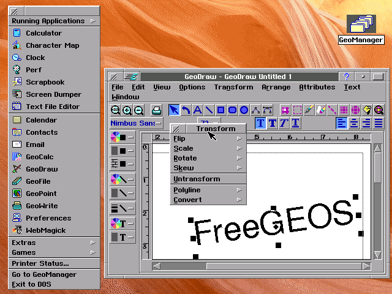

# PC/GEOS
This repository is the official place to hold all the source codes around the PC/GEOS graphical user
interface and its sophisticated applications. It is the source to build SDK and release version of PC/GEOS.
It is the place to collaborate on further developments.

The base of this repository is the source code used to build Breadbox Ensemble 4.13 reduced by some modules identified as critical in regard to the license chosen for the repository.

While now the WATCOM is used to compile the C parts, the full SDK is available for Windows and Linux.

# How to build?

## Prerequisites
The SDK requires "sed" (https://en.wikipedia.org/wiki/Sed) and "perl" (https://en.wikipedia.org/wiki/Perl) to be installed. Both are pre-installed in most Linux-distributions. Windows-users should install "sed" by adding the usr/bin of the official git distribution (https://git-scm.com) to the path (or Cygwin), and should use the perl-variant "Strawberry Perl" (http://strawberryperl.com/).

On Linux if you want to use swat for debugging with good system integration is is required to install xdotools package. It ensures swat receives the keyboard focus once needed. 

## Install WATCOM and set environment
- Unzip WATCOM tools from a suitable [release-tar-gz](https://github.com/open-watcom/open-watcom-v2/releases/download/2020-12-01-Build/ow-snapshot.tar.gz) snapshot (currently tested: 2020-12-01) for instance to `C:\WATCOM-V2`
- add WATCOM env variable: `WATCOM=c:\WATCOM-V2`
- set `BASEBOX=basebox` to use the advanced emulator backend from [pcgeos-basebox](https://github.com/bluewaysw/pcgeos-basebox/tags) if it is on the executable path, alternatively you may provide the full path to the executable as well
- set `ROOT_DIR` to the root of the checkout
- set `LOCAL_ROOT` to a local working directory (can be empty at first, but should be under `pcgeos`, so you can use it for development of your own apps as well)
- add `C:\WATCOM-V2\binnt` to your system path variable
- add `bin` of the checkout of this repo to path variable
- add sed and perl to path variable - note the order to avoid loading the wrong Perl version. Example:

        set WATCOM=c:\WATCOM-V2
        set ROOT_DIR=C:\Geos\pcgeos
        set LOCAL_ROOT=c:\Geos\pcgeos\Local
        set BASEBOX=basebox
        PATH %WATCOM%\binnt;%ROOT_DIR%\bin;C:\Geos\pcgeos-basebox\binnt;%PATH%;c:\Program Files\Git\usr\bin

Document is work in progress.... stay tuned!

## Building PC/GEOS SDK
Build pmake tool:

    cd %ROOT_DIR%/Tools/pmake/pmake
    wmake install

Build all the other SDK Tools:

    cd %ROOT_DIR%/Installed/Tools
    pmake install

Build all PC/GEOS (target) components:

    cd %ROOT_DIR%/Installed
    pmake

Build the target environment:

    perl %ROOT_DIR%/Tools/build/product/bbxensem/Scripts/buildbbx.pl

  - the answers to the questions from the above perl-script are:
    - nt (for the platform)
    - y (for the EC version)
      - Alternatively, reply "n" for the NC ("release") version that is faster and corresponds to the actual release
      - The EC ("debug") version has stricter error checking and is better suited for debugging
    - n (as the build for Double-Byte Character Sets is not yet fully functional)
    - y (for the geodes)
    - n (for the VM files)
    - and then you'll have to enter the path to a "gbuild"-folder in your LOCAL_ROOT-folder.
  - BTW: It's expected that the current version of the perl-script creates several "Could not find file _name_ in any of the source trees."-messages.
  - Advanced use: You can use the EC target and the NC target simultaneously.
    - Build the EC target (answers nt/y/n/y/n/path). The path should end with `gbuild.ec`.
    - Build the NC target (answers nt/y/n/y/n/path). The path should end with `gbuild` or `gbuild.nc`.
    - The `target` command (see below) starts the EC target by default. To start the NC target, enter `target -n`.

Launch the target environment in dosbox:
- make sure dosbox is added to your path variable, or [pcgeos-basebox](https://github.com/bluewaysw/pcgeos-basebox/tags) is installed and configured using BASEBOX environmental variable
- `%ROOT_DIR%/bin/target` to launch the EC ("debug") version
  - the "swat" debugger stops immediately after the first stage of the boot process
  - enter `quit` at the "=>" prompt to detach the debugger and launch PC/GEOS stand-alone
    - or: enter `c` to launch with the debugger running in the background (slower)

## Customize target environment
If you want to customize the target environment settings only for yourself, you should not change the file `%ROOT_DIR%/bin/basebox.conf`.
- Create a file called basebox_user.conf in %LOCAL_ROOT% folder.
- Enter the new settings here. These settings overwrite those from basebox.conf. Example:
  - [cpu]
  - cycles=55000

## Run the target in 86Box
Instead of DOSBox/basebox, the target can run on an emulated PC in [86Box](https://86box.net) (version 6.0 or newer). The target is put on a bootable FreeDOS hard disk image and swat connects over the emulated serial port, using the serial Swat stub.

Preconditions:
- 86Box 6.0+ with its [ROM set](https://github.com/86Box/roms). Set `BOX86_ROMS` to the ROM directory if 86Box does not find it on its own.
- Linux: `socat` (86Box forwards the serial port pseudo terminal to a local TCP port with it).
- The tools and the serial stub are built (`pmake install` in `Tools`, `pmake` in `Installed`).
- FreeDOS: set `FREEDOS_IMG` to a bootable FreeDOS hard disk image, e.g. `FD14LITE.IMG` from FreeDOS 1.4 LiteUSB. Without it, `bin/box86.pl` downloads the files listed in `bin/86box/freedos.manifest` (FreeDOS 1.4 LiteUSB, the 8086 FreeDOS kernel and FreeCOM) and checks their SHA-256 before use.

Use:
- Set `USE_86BOX` to the absolute path of the 86Box executable, like `BASEBOX` for basebox (e.g. `set USE_86BOX=C:\86Box\86Box.exe`; `USE_86BOX=1` uses 86Box from the path), and build the target as usual (`buildbbx`): the build also creates or updates the disk image `%LOCAL_ROOT%/86box/<platform>.<ec|nec>/geos.img`.
- `target` (or `target -n`) syncs the image, starts 86Box and swat.
- `TARGET_PLATFORM` selects the emulated machine (default `pm32`):
  - `pm32`: Pentium 100, 32 MB, S3 Trio64 PCI, PS/2 mouse, serial link at 115200 baud
  - `pm16`, `rm16`: 286 at 12.5 MHz, Cirrus Logic GD5428 ISA, serial mouse on COM2, serial link at 57600 baud. These need a FreeDOS image whose MBR and boot code run on a 286 (FAT16 partition, MBR from FreeDOS FDISK); the downloaded kernel is the 8086 build.
- The image is updated in place: new and changed files of the target are copied, files removed from the target are deleted in `ENSEMBLE/SYSTEM`, `ENSEMBLE/WORLD` and `ENSEMBLE/FREEGEOS` only, so data written inside the emulator is kept. `perl %ROOT_DIR%/bin/box86.pl image --fresh` recreates it.
- `GEOS_CDROM_DRIVE` may name an ISO image, which is attached as CD-ROM (drive `R:` if the FreeDOS image contains the CD-ROM drivers). `GEOS_CENTRAL_STORAGE` is only supported with basebox.

First start of a new machine:
- `pm32`: the BIOS reports a CMOS checksum error once; press F1. 86Box keeps the settings.
- `pm16`, `rm16`: the Award 286 BIOS cannot detect hard disks. Enter setup with Ctrl-Alt-Esc, set Disk 1 to type 49 with the cylinders printed by `target`, 16 heads and 63 sectors, then save with F10 and F5.

The machine configuration is generated from `bin/86box/*.cfg` on every start. Personal changes go to `%LOCAL_ROOT%/86box_user.cfg` (all platforms) or `%LOCAL_ROOT%/86box_user.<platform>.cfg`, in 86Box's configuration file format; the `[img86box]` section of these files changes the disk image settings (see `bin/86box/base.cfg`).

# How to develop?

PC/GEOS comes with extensive technical documentation that describes tools, programming languages and API calls from the perspective of an SDK user. This documentation can be found in the `TechDocs` folder and is available in Markdown format.

You can find a browsable, searchable version of the documentation here: https://bluewaysw.github.io/pcgeos/

##
We are on https://discord.com/ for more efficient collaboration. Please register at https://discord.gg/qtMqgZXhf9 for blueway.Softworks or use an existing discord-account to get access to our developer community. Welcome!
